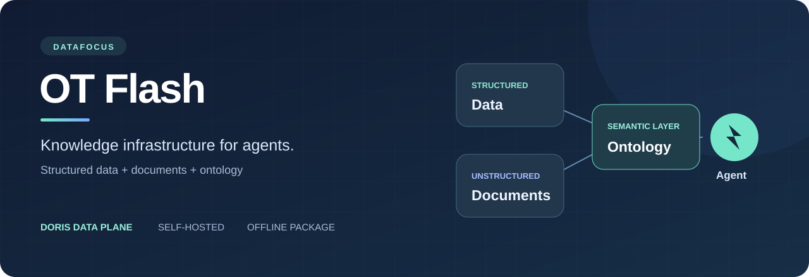
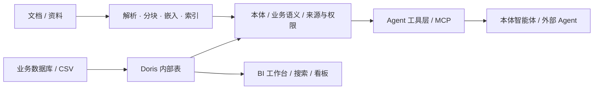

<p align="center">
  
</p>

<h1 align="center">DataFocus OT Flash</h1>
<p align="center"><strong>面向 Agent 的结构化与非结构化融合知识后台</strong></p>
<p align="center">接入业务数据，整理文档知识，用本体连接业务语义，让 Agent 在可追溯的数据与证据上工作。</p>

<p align="center">
  <a href="https://github.com/FocusSearch/DataFocus_OT_Flash/releases/tag/v0.1.0-test-r53"></a>
  
  
  
</p>

<p align="center">
  <a href="#下载">下载安装包</a> ·
  <a href="#核心功能">核心功能</a> ·
  <a href="docs/INSTALL.md">安装指南</a> ·
  <a href="docs/RELEASE-r53.md">r53 更新与验收范围</a> ·
  <a href="README.en.md">English</a>
</p>

## 产品定位

**OT Flash 是 DataFocus 面向 Agent 知识服务的精简发行版本。** 它以 Apache Doris 承载结构化业务数据，结合文档处理、知识检索和本体建模，为 Agent 提供查询数据、理解业务对象、检索资料和追溯来源的后台能力。

产品聚焦知识接入、知识组织和知识使用；这一发行线不包含完整 ETL 产品能力和 AutoML。原有 BI 工作台继续提供搜索、问答和看板等业务入口，帮助用户从数据核对到 Agent 使用保持一致的工作环境。

“轻便快速”体现为聚焦的产品范围、Doris 数据底座和可复用的原产品流程。当前分发的是包含运行依赖的完整离线包，大小约 **6.70 GiB**，需要服务器环境部署。

## 下载

| 当前发行 | 说明 |
| --- | --- |
| **[OT Flash 0.1.0-test · r53](https://github.com/FocusSearch/DataFocus_OT_Flash/releases/tag/v0.1.0-test-r53)** | 测试发行候选，供隔离环境安装与评估 |
| 操作系统 / 架构 | CentOS 7 / x86_64 |
| 完整包大小 | 7,191,482,492 字节，约 6.70 GiB |
| 分发方式 | GitHub Release 四个分卷，合并后与原完整安装包逐字节一致 |
| 安装包内容 | 原安装引导、产品服务、Doris 数据底座及所需离线运行依赖 |

**[前往 Release 下载 →](https://github.com/FocusSearch/DataFocus_OT_Flash/releases/tag/v0.1.0-test-r53)**

GitHub 单个 Release 文件必须小于 2 GiB，因此本包按四卷分发。下载本仓库的 [download-r53.sh](scripts/download-r53.sh)，在准备存放安装包的目录执行：

```bash
bash download-r53.sh
```

脚本会直接下载四个分卷、支持续传、校验每卷摘要、合并归档，再核对完整包 SHA-256。也可以按 [手动下载与合并说明](docs/DOWNLOAD.md) 操作。GitHub 自动生成的 **Source code** 压缩包仅包含此仓库资料，安装产品请使用 Release 中的安装包分卷。

## 核心功能

### 01 · 业务数据接入与 Doris 查询

- 沿用 DataFocus 原有 CSV、数据库接入和表管理入口。
- 导入的数据物理写入 Doris 内部表，再经原查询路由读取，为分析和 Agent 查询提供统一的结构化底座。
- 保留 FocusSearch → BI → 数据引擎的原搜索分析链路，适配 Doris SQL 方言、实际字段类型和执行回执。
- JDBC 接入覆盖 MySQL、PostgreSQL、SQL Server、Oracle、DB2、ClickHouse、SAP HANA、OceanBase，并提供 TiDB、Doris、Greenplum 的协议兼容接入；各数据库的实库验收范围见版本说明。

### 02 · 文档知识处理与检索

- 批量上传文档，管理导入任务、处理进度和最终知识资产。
- 上传阶段提供分块与整文件 SHA-256 校验、预检及断点恢复能力。
- Worker 依次执行获取、解析、分块、嵌入和索引，为后续检索提供知识资产。
- 知识检索与原文定位能力保留文档、分块和来源引用，使 Agent 的回答能够回到实际资料核对。
- OCR、模型服务等外部能力按目标站点配置，具体文档格式和效果需结合对应解析器验收。

### 03 · 本体与业务语义

- 围绕业务对象、属性、关系和分析规则组织知识，将数据库字段与文档语义连接到业务概念。
- 提供真实来源读取、候选建模、只读预览、草稿续改以及发布维护工具链。
- r53 吸收了本体维护批量读取、发布闭包复用和精确修订检查优化，减少重复读取，同时保留现行来源与权限检查。
- 发布和自动维护沿用原授权及治理条件。**r53 中候选创建、预览和草稿续改已通过；正式发布及发布后融合查询尚未完成验收。**

### 04 · Agent 工具与使用入口

- 内置本体智能体会话，结合表结构读取、只读 SQL、搜索分析及知识检索工具处理业务问题。
- 通过原 MCP / 工具接口向已授权的 Agent 提供能力；接口可用范围取决于站点配置与现行权限。
- “你好”“hi”等常见招呼走本地路由，减少不必要的模型调用。
- 保留流式正文和处理过程展示；外部模型网关须正确区分正文与 reasoning 字段。
- 模型服务由部署站点配置，安装包不携带可直接调用的模型账号或站点凭据。

### 05 · BI 工作台与多语言

- 小慧、搜索、问答和数据看板收拢到 BI 工作台，保留成熟的分析和展示入口。
- 提供 24 种界面语言、21 种搜索语言；具体语言入口与版本覆盖见产品界面。
- r53 继承表名输入、语言切换及 Doris 别名等相关修补；此次没有对每种语言重新做完整业务回归。

### 06 · 自部署与运维

- 完整离线安装包，沿用原安装、升级、备份及恢复引导。
- Doris 数据备份接入原生在线快照和 S3 兼容存储，可接入现有 S3 / MinIO；安装器也提供独立内部备份组件。
- 备份不要求停服；恢复会中断业务并按原流程恢复服务。
- 保留原身份、权限和 AppCenter / SysMgr 授权机制。新实例需完成自己的授权与初始化配置。

## 知识如何流动



这是产品的总体能力结构；部署开关、授权、模型服务和发布治理配置决定各条链路在当前实例的可用状态。r53 的实际验收范围见下表。

## r53 实际验证范围

| 功能链路 | 当前结果 |
| --- | --- |
| CentOS 7 完整包升级与服务恢复 | 已通过；2,145 个安装文件匹配，356 个迁移成功、0 失败 |
| 管理员登录、招呼本地路由、Doris 原读表 | 已通过 |
| 2,505 行结构化数据导入与来源登记 | 已通过物理结构、全量行及真实 JDBC 回执核对 |
| 两份文档批量上传 → 封存 → 解析 → 嵌入 → 索引 | 已通过，成功 2、失败 0 |
| 本体来源读取、候选创建、预览、草稿续改 | 已通过 |
| 本体正式发布、发布后查询与完整分页 | 未完成验收；测试实例缺少原校验预算账户，发布信任也需预先配置 |
| 融合引用、冲突处理、局部自动更新 | 未完成本发行包端到端验收 |
| 每一种数据库、文档格式和界面语言 | 未逐项进行本轮全量验收 |

详细更新、修补内容与已知限制请阅读 [r53 版本说明](docs/RELEASE-r53.md)。本版本标记为 **Pre-release / 测试发行候选**。

## 适用场景

- **企业 Agent 的知识后台**：将业务表和文档资料接入同一知识服务体系，逐步建立业务对象与语义。
- **业务数据问答与核对**：在原 BI 工作台中搜索、查看数据，让 Agent 使用真实表结构和查询结果。
- **文档知识库建设**：批量整理制度、产品资料和操作说明，形成可检索、有来源定位的知识资产。
- **本体建模与评估**：基于真实数据创建和预览分析候选，在配置治理条件后继续验证发布与维护流程。

## 安装与授权

请先阅读 [安装指南](docs/INSTALL.md)。r53 面向 CentOS 7 x86_64；本次不将其他操作系统的旧包作为同版本提供。

产品沿用原授权机制，安装包下载不等于获得任意生产实例的授权。首次安装需要目标实例的授权、全局 AI 服务和安装配置。默认管理员为 `admin`，初始密码为 `2020@Datafocus`，请按原流程完成账户初始化与改密。

## 仓库说明

本仓库用于 **OT Flash 发行包、产品介绍和安装资料的分发**。产品源码的授权范围、第三方组件许可证及对应源码提供方式以安装包随附资料为准；公开下载本发行资料不改变产品原有授权条款。

发现问题时，请在 [Issues](https://github.com/FocusSearch/DataFocus_OT_Flash/issues) 提供版本、操作系统、复现步骤和去除敏感信息后的错误日志。
